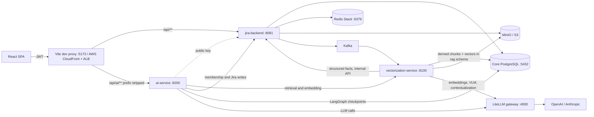

# Sprint Orchestra Core

Backend and AI platform for a Jira-style sprint workspace. The repository contains the Spring core
API, an event-driven vectorization service, a corrective-RAG agent, durable LangGraph
workflows, local infrastructure, an AI eval gate, load tests, and observability tooling. The React
SPA lives in the sibling `sprint-orchestra-studio` repository.

Not yet hardened for multi-tenant production; the open items are listed under
[Security posture and known gaps](#security-posture-and-known-gaps).

## What is implemented

- Jira-like spaces, sprints, issues, comments, attachments, groups, GitHub links, and sprint history.
- RS256 JWTs verified by each service itself (jira-backend publishes its public key at
  `/.well-known/jwks.json`), with identity taken from validated claims rather than client headers.
  Service-to-service calls use a separate internal token.
- PostgreSQL/Flyway core schema, OpenSearch search, Redis Stack, MinIO/S3-compatible storage, and
  Kafka content/attachment events.
- Event-driven RAG ingestion: HTML/document extraction (Docling, OCR, VLM fallback), structure-aware
  chunking with parent sections, embeddings in pgvector, OpenSearch BM25, RRF fusion, and
  cross-encoder reranking.
- Corrective RAG with citations, abstention, exact metadata/history tools, runtime verification,
  Fast/Deep modes with a multi-agent path, Redis-backed answer caching, streaming, and cost/latency
  metrics.
- An eval gate: retrieval hit@k, RAGAS, Sprint Recovery scenarios and a prompt-injection probe.
- Ask AI answer feedback with an owner-scoped review inbox, captured evidence and review revisions.
- AI task drafting, epic planning, sprint health analysis, durable human-approved epic rollout, and
  durable sprint-recovery workflows with Postgres checkpoints, retry, history, and time travel.
- LiteLLM gateway as the single LLM/embedding egress for both Python services (per-service keys,
  budgets, rate limits, model routing) and a Prometheus/Grafana/Phoenix overlay.
- MCP server for external agents (Claude Code, Cursor): ask, ticket context, similar work and
  sprint risk as tools, scoped server-side to the caller's spaces; stateless Streamable HTTP,
  JWT-authenticated.

## Runtime architecture



The browser talks to one origin. Locally that is the Vite dev server, which proxies `/api/ai/*` to
ai-service and the rest of `/api` to jira-backend; on AWS, CloudFront and an Application Load Balancer do the same routing. There is no gateway service doing authentication: every
request to jira-backend or ai-service needs either a user JWT, which the service verifies itself, or
the internal service token (`X-Internal-Token`), used by ai-service, eval scripts, and ops scripts.
Ports `8081`, `8100`, and `8200` should still stay off the public internet.

PostgreSQL is shared: business records stay in `pocdb.public`; derived search data lives in
`pocdb.rag`. There is no second database container or port 5433. Exact issue/sprint/history queries
read the source through jira-backend, while semantic search uses `rag.chunks`.

## Repository map

| Path | Responsibility |
|------|----------------|
| `jira-backend/` | Spring Boot domain API, business data, search bar (OpenSearch), object storage, and Kafka publishing |
| `vectorization-service/` | Kafka ingestion, document extraction/chunking, embeddings, pgvector, hybrid retrieval, reranking |
| `ai-service/` | Corrective RAG, structured tools, drafting/planning, LangGraph rollout and sprint recovery, MCP server, eval gate |
| `docs/` | Architecture, schema/API design, AWS deployment, and an ER diagram |
| `observability/` | Optional Prometheus, Grafana, and Phoenix overlay |
| `litellm-gateway/` | LLM/embedding egress gateway — per-service keys, budgets, rate limits, model routing, trace export |
| `seed-data/` | Demo workspaces for local and staging environments |
| `scripts/` | Local stack, test and eval orchestration |

Important documents:

- [Architecture](docs/ARCHITECTURE.md)
- [AI architecture and workflows](docs/AI_ARCHITECTURE.md)
- [AI service](ai-service/README.md)
- [Vectorization service](vectorization-service/README.md)
- [Database schema](docs/DATABASE_SCHEMA_CORE.md)
- [Core API design](docs/API_DESIGN_CORE.md)
- [AI Feedback](docs/AI_FEEDBACK.md)

## Local development

Prerequisites: JDK 17, Python 3.11, Docker Compose, and Node 20+ for the separate SPA. Real AI calls
go through the LiteLLM gateway (`litellm-gateway/`, started by `docker compose`), which needs
`OPENAI_API_KEY`, `ANTHROPIC_API_KEY` and `GEMINI_API_KEY` in the root `./.env` (gitignored); hermetic unit tests need none of them.

The simplest path is:

```bash
# Create each Python venv once and install its requirements first.
scripts/dev_up.sh
scripts/dev_up.sh status
```

`dev_up.sh` starts or reuses Compose infrastructure, `jira-backend`, both Python services, and the
sibling SPA (whose Vite dev server is also the API proxy).
Processes started by the script write logs below `/tmp/sprint-orchestra-dev/` and can be stopped with
`scripts/dev_up.sh down`.

Manual startup:

```bash
docker compose up -d
./gradlew :jira-backend:bootRun

cd vectorization-service
python -m venv .venv && source .venv/bin/activate
pip install -r requirements.txt
cp .env.example .env
uvicorn app.main:app --port 8100

cd ../ai-service
python -m venv .venv && source .venv/bin/activate
pip install -r requirements.txt
cp .env.example .env
uvicorn app.main:app --host 127.0.0.1 --port 8200

cd ../../sprint-orchestra-studio
npm install && npm run dev        # http://localhost:5173, proxies the API
```

On first start, jira-backend generates a local JWT signing key at
`~/.sprint-orchestra/jwt-dev-signing-key.pem` and reuses it after restarts.

Default infrastructure:

| Service | Port | Notes |
|---------|------|-------|
| Vite dev server | 5173 | Browser entry point and API proxy (in `sprint-orchestra-studio`) |
| jira-backend | 8081 | Internal core API |
| vectorization-service | 8100 | Internal retrieval API |
| ai-service | 8200 | Internal AI API |
| PostgreSQL | 5432 | Core data and LangGraph checkpoints |
| PostgreSQL `pocdb.rag` | 5432 (same instance) | Derived text, vectors, extraction cache and ingestion state; restricted `rag` role |
| Redis Stack | 6379 | Spring cache and AI semantic cache/RediSearch |
| Kafka / Kafka UI | 9092 / 8989 | Event bus and local UI |
| MinIO API / console | 9000 / 9001 | Attachment object storage |
| LiteLLM gateway | 4000 | LLM/embedding egress for both Python services; starts with `docker compose up` |

AI defaults enable Redis caching, durable rollout and sprint recovery. For a minimal standalone AI
process, either start Redis/Postgres or explicitly disable the features in `ai-service/.env.example`.

## API entry points

Browser calls use these paths on the app's own origin:

| Area | Path |
|------|--------------|
| Auth | `/api/auth/**` |
| Core Jira API | `/api/**` |
| Ask AI and AI workflows | `/api/ai/**` |
| MCP server for external agents | `/api/ai/mcp` |
| Swagger UI | `/swagger-ui.html` |
| OpenAPI JSON | `/v3/api-docs` |

The internal Python endpoints and their exact request/response shapes are documented in the two
service READMEs and generated FastAPI OpenAPI documents.

## Data and RAG flow

1. A committed issue, comment, history, or attachment change emits a Kafka event.
2. `vectorization-service` consumes at least once and applies deterministic upserts/deletes to its
   own pgvector and OpenSearch chunk index. Attachment binaries are fetched from MinIO/S3.
3. `/search` combines dense and lexical ranks using RRF and optionally reranks candidates with a
   cross-encoder. Structured endpoints provide exact issue, sprint, comment, detail, attachment, and
   transition data when semantic top-k retrieval is the wrong abstraction.
4. `ai-service` exposes eight retrieval tools to the model and injects the caller's authorized `space_ids` in code.
   The model can select queries and filters but cannot expand authorization scope.
5. The CRAG loop can reformulate and retrieve again, then verifies grounded claims, returns citations,
   or uses the fixed abstention contract when evidence is insufficient.

The durable workflows use LangGraph with Postgres checkpointing:

- Epic rollout pauses for approval before any Jira write and supports idempotent resume/retry.
- Sprint recovery diagnoses risk, clarifies missing facts, proposes a plan, pauses for human review,
  executes approved actions, and supports re-evaluation/history/time travel.
- Workflow reads and mutations are owner-authorized and recheck space membership on resume.

## Configuration

Configuration is environment-driven. Start from:

- `ai-service/.env.example`
- `vectorization-service/.env.example`
- `jira-backend/src/main/resources/application.yml`

The trust settings that must be set outside local development:

- `APP_JWT_PRIVATE_KEY` (PKCS#8 PEM) on jira-backend, with `APP_JWT_ALLOW_GENERATED_KEY=false` so a
  missing key fails startup instead of each instance minting its own.
- `AI_JWT_JWKS_URL` on ai-service, pointing at jira-backend's `/.well-known/jwks.json` (or, later, an
  external issuer's; set `APP_JWT_JWK_SET_URI` on jira-backend to match).
- `INTERNAL_SERVICE_TOKEN` on jira-backend, `AI_INTERNAL_SERVICE_TOKEN` on ai-service and
  `VEC_INTERNAL_SERVICE_TOKEN` on vectorization-service, the same
  value: it authenticates service calls and signs AI feedback receipts.

Never deploy with the repository's development secrets or plaintext defaults.

## Build and test

Run the CI-equivalent suites locally:

```bash
scripts/run_all_tests.sh

# Individual suites
scripts/run_all_tests.sh ai
scripts/run_all_tests.sh vec
scripts/run_all_tests.sh backend
```

The AI durable-workflow integration tests use PostgreSQL when reachable; CI starts an isolated
Postgres service so crash/resume cases cannot silently remain skipped. GitHub Actions runs all three
service suites from `.github/workflows/ci.yml`, and also builds all three container images.

### Container images

Each service has a Dockerfile. jira-backend builds from the repo root (Gradle multi-project), the
Python ones from their own directory:

```bash
docker build -f jira-backend/Dockerfile -t sprint-orchestra/jira-backend .
docker build -t sprint-orchestra/vectorization-service vectorization-service
docker build -t sprint-orchestra/ai-service ai-service
```

Configuration comes from environment variables (Spring relaxed binding for jira-backend), e.g.
`SPRING_DATASOURCE_URL`, `SPRING_DATA_REDIS_HOST`, `SPRING_KAFKA_BOOTSTRAP_SERVERS`,
`APP_OPENSEARCH_URI`, `APP_ATTACHMENTS_S3_ENDPOINT`. The Gradle wrapper is pinned to 8.x because the
Spring Boot 3.2 plugin cannot package (`bootJar`) on Gradle 9.

Beyond unit tests:

- `scripts/run_rag_eval.sh smoke|gate` runs the AI eval gate against the local stack; see
  [ai-service/README.md](ai-service/README.md#eval-gate).
- `observability/` holds the Prometheus, Grafana and Phoenix setup.

## Security posture and known gaps

Implemented controls include RS256 JWT verification in every service, identity taken only from
verified claims or the internal service token, space-scoped AI retrieval, workflow-owner checks, resume-time membership checks, bounded
agent/workflow loops, and idempotent durable writes.

Before handling real users or exposing this publicly, at minimum:

- Decide whether the public demo accounts (password `123`, one-click buttons on the login page)
  should exist on a public deployment; `app.auth.demo-accounts-enabled=false` hides the buttons.
  Passwords are bcrypt hashes (V35); `/api/users` needs a sign-in, and creating or deleting accounts
  needs the internal service token.
- Enforce membership/role authorization consistently on every core resource mutation and remove APIs
  that accept an arbitrary user id as their authorization source.
- Bind internal ports to private interfaces/security groups; expose only HTTPS through CloudFront.
- Add WAF rate rules at the edge. Per-user AI limits already exist in ai-service (20 requests a
  minute, $2 a day by default), and LiteLLM budgets cap each service's total.
- Replace default JWT/internal/LiteLLM/DB/MinIO secrets, restrict CORS, enable TLS, and store secrets
  in a managed secret store.
- Add an outbox/CDC publisher and DLQ. The current `AFTER_COMMIT` Kafka publisher has a crash window
  between database commit and publish.
- Extend tracing to jira-backend and the Kafka hop. ai-service, vectorization-service and the
  gateway already share one trace per request.

This is deliberately not labeled production-ready.
