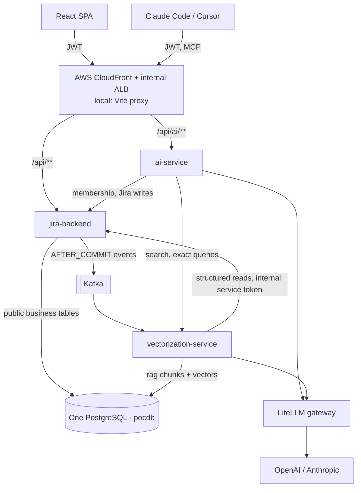
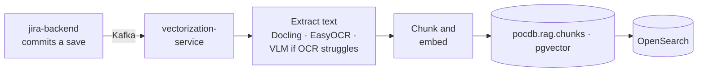
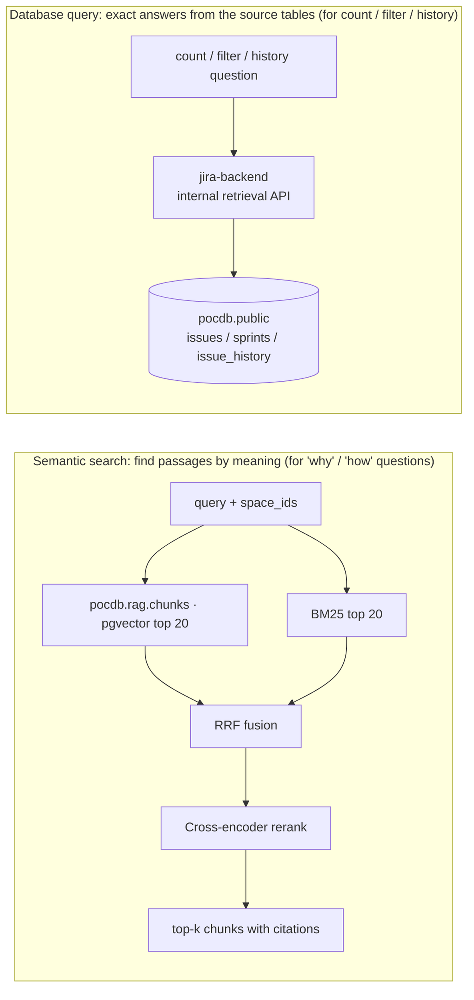
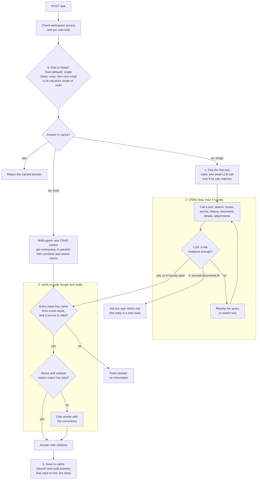
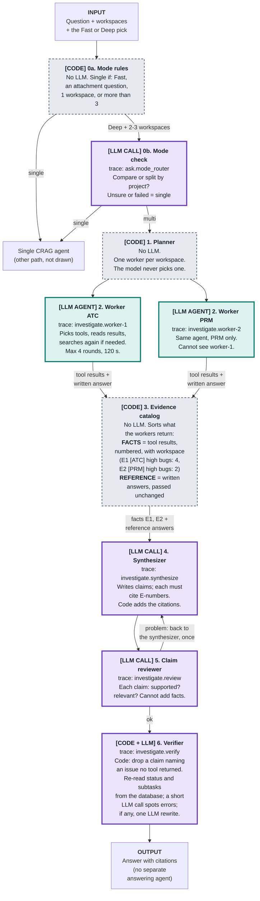
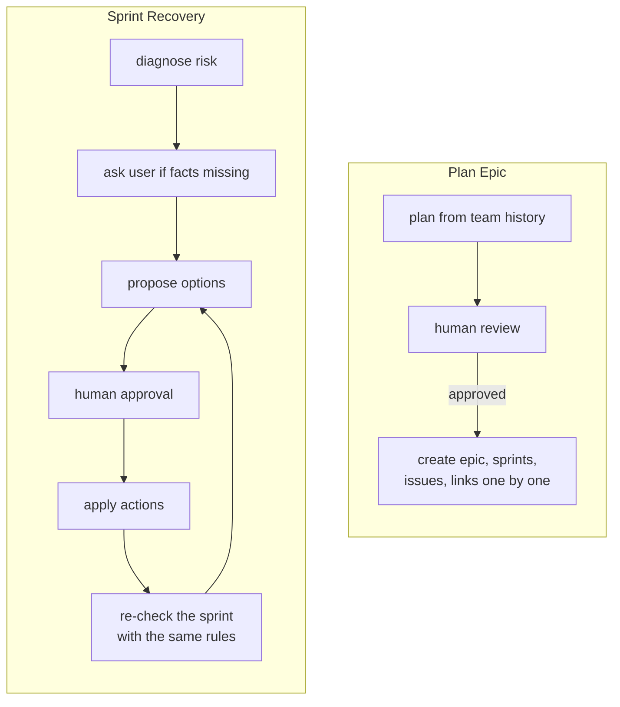

# AI Architecture and Workflows

A high-level map of Sprint Orchestra's AI layer: which service does what, where data lives, and how
the main workflows run. Each section links to the README that has the detail.
For the platform as a whole see [ARCHITECTURE.md](ARCHITECTURE.md).

Services refer to models only by gateway route alias, so changing a model is a gateway config change
(`litellm-gateway/config.yaml`), not a code change.

## Contents

1. [Components](#1-components)
2. [Where data lives](#2-where-data-lives)
3. [Ingestion: from save to searchable](#3-ingestion-from-save-to-searchable)
4. [Retrieval](#4-retrieval)
5. [Ask AI: question to cited answer](#5-ask-ai-question-to-cited-answer)
6. [Workflows that write to Jira](#6-workflows-that-write-to-jira)
7. [Other AI features and MCP](#7-other-ai-features-and-mcp)
8. [Models, gateway and outages](#8-models-gateway-and-outages)
9. [Safety boundaries](#9-safety-boundaries)
10. [Observability and evaluation](#10-observability-and-evaluation)
11. [Known gaps](#11-known-gaps)

## 1. Components

One rule decides the split: **the service that owns the data exposes primitives; the service that
owns the feature composes them.**

| Component | Owns |
|-----------|------|
| Edge | AWS CloudFront and an internal Application Load Balancer that only CloudFront can reach (locally the Vite dev proxy). Routing only; each service verifies the JWT itself. The same images run locally and on AWS; only environment variables differ. |
| `jira-backend` | Jira data and every Jira write, the search bar, Kafka events, signing login JWTs |
| `vectorization-service` | The RAG index: ingestion, chunking, embedding, hybrid search, forwarding structured queries to jira-backend ([README](../vectorization-service/README.md)) |
| `ai-service` | Ask AI, the AI features, LangGraph workflows, the answer cache, the MCP server ([README](../ai-service/README.md)) |
| `litellm-gateway` | Provider keys, per-service budgets, model routing and fallback ([README](../litellm-gateway/README.md)) |

## 2. Where data lives

One PostgreSQL instance serves the application. Within `pocdb`, `public` contains the authoritative
business records and `rag` contains derived search data. pgvector is an extension in that database,
not another server. Counting/filtering/history queries read the original business tables through
jira-backend; no issue/sprint/history replicas are maintained by the vector service.

| Store | Holds | Used for |
|-------|-------|----------|
| `pocdb.public` | Original issues, sprints, `issue_history`, users, permissions, AI feedback and workflow persistence | Exact counts, filters and transitions via jira-backend; workflow resume |
| `pocdb.rag.chunks` | Text, `vector(1024)`, space, issue key and citation/provenance metadata | Semantic search |
| `pocdb.rag.ingestion_status` | Per-source indexing progress and content-change watermark | `/ingestion/status`; cache freshness |
| `pocdb.rag.vlm_result_cache` / `vlm_retry_queue` | Successful paid extraction outputs and pending retries | Reuse extraction results; recover failed attachment processing |
| OpenSearch `orchestra-chunks` | Derived chunk documents | BM25 keyword search |
| OpenSearch `orchestra-issues` / `comments` | One document per business issue/comment | Search bar |
| Redis Stack | Answer cache, per-user request/spend counters and backend sessions | Ask AI cache; quotas; GitHub login across instances |
| MinIO / S3 | Attachment files | Ingestion |

The vector service connects using the restricted `rag` role, which can read/write derived tables but
cannot read/write business tables. Schema separation organizes ownership and permissions; it does
not isolate CPU or disk resources.

## 3. Ingestion: from save to searchable

- **Saving returns immediately.** Indexing runs in the background off Kafka. Deletes are events too,
  so a deleted comment stops being cited.
- **Only searchable text goes through Kafka.** Title, description, comments, attachments and the
  parent's title are indexed. Status, priority, sprint and assignee are not; Ask AI reads them live from
  jira-backend (section 4), so a status drag sends no event and re-embeds nothing.
- **Extraction:** Docling for documents, EasyOCR for images. Only an image or page OCR could not read
  well goes to a vision model (Gemini Flash).
- **Chunking:** issues and comments are stored whole; long attachment sections are split at headings
  and paragraphs, and each chunk keeps its heading path and location (page, slide, sheet, image box).
  A PDF is chunked as one document, not page by page: a section that crosses a page break stays
  together, running headers and footers are dropped, and heading levels are re-inferred from numbering.
- **Embedding:** `text-embedding-3-small`, truncated to 1024 dimensions.

Detail: [vectorization-service README](../vectorization-service/README.md#chunking--attachment-handling).

## 4. Retrieval

Top: semantic search, which returns the closest passages. Bottom: database query, which returns exact
numbers. Counting, filtering and history questions skip the ranking above. They read the authoritative
business tables in `pocdb.public` through jira-backend's internal API; there are no Kafka-fed copies of
those tables.

Vectors handle paraphrase, BM25 handles exact identifiers like `W-7734`; RRF merges the two by rank,
and a cross-encoder rescores the top 20.

Counting and history questions don't use this path. They go to exact endpoints (`/issues/query`,
`/issues/history`, `/sprints/query`) that query the source in read-only repeatable-read transactions. Totals/breakdowns cover all matches; the row sample is limited.

## 5. Ask AI: question to cited answer

The numbers in the diagram match the steps below. If both answer providers are down, `/ask` returns
the most relevant sources, marked "not a generated answer", instead of failing (section 8).

0. **Fast or Deep.** The user picks in the UI; Fast is the default and always runs one CRAG agent
   (the loop below), with no extra call. Deep lets multi run, but only for a question that compares
   two or three workspaces, e.g. "compare open bugs in PRM and DVQPLH" with both selected. One
   workspace → single, by rule. With two or three, one short classifier call decides whether the
   question compares them, preferring single. In Deep, a follow-up can go to multi too; the
   classifier sees only the question, plus a note that it is a follow-up. Attachment questions stay
   single. Multi runs one worker (a normal CRAG agent) per workspace in parallel; code assigns
   the scopes, an LLM combines the reports into claims that cite evidence IDs, a reviewer drops
   unsupported claims, and the same code verification as single runs last.
   **Long chats.** The UI sends the whole chat with every question. Once the turns before the latest
   question and answer pass about 8,000 tokens, the answer model summarizes them once (at most 300
   words, keeping every issue key with its status, every number, date, sprint and name). The summary
   goes back to the UI and comes back with the next question, so it is written once per chat; the
   latest question and answer stay word for word. Single and multi get the same compacted chat.
   Detail: [ai-service README](../ai-service/README.md).
1. **Route.** Every question calls at least one tool; the router only picks which one first. Keyword rules first, with no LLM call. Only if no rule matches, one short LLM call picks the
   first tool (same model as the answer agent by default; `AI_ROUTER_*` can point it at a smaller
   one); low confidence falls back to semantic search. The choice is forced on round 1; the model can
   switch tools afterwards. That call also judges `source_scope` (source named, deliberate aggregate,
   or one fact without a named document, e.g. "What is the total amount due?"); rule matches get a
   fixed value. The last one makes the loop ask back after searching, unless the question carries an
   issue key, date or quoted title, which resets it to "named". If unsure, it falls back to semantic search
   rather than guessing an exact source.
2. **Retrieve and correct.** The model calls tools (semantic search, issue queries, sprint queries,
   history, comments, details, attachments). The model itself judges whether the evidence answers the
   question (there is no separate grader); if not, it rephrases or switches tool, up to 4 rounds.
   After round 4 it must answer with what it has, and that answer is still verified.
3. **Verify (code).** Single and multi answers both go through it. First, every issue key in the
   answer must come from this question's tool results, all its rounds pooled (the final `(KEY, ...)` is the source claim and may
   list several issues), and an answer built from search must cite one of its sources. Earlier turns
   are never evidence: every follow-up searches again. A key that is only in the chat may be
   mentioned (not cited) once a database lookup confirms it exists in the user's workspaces
   ("PRM-30 is planned, so it's left out"). Single throws the whole answer away for one unfound key, because its prose has
   no reliable sentence boundaries; multi drops only the claim that names it and says one was left
   out, since each claim is a separate item tied to its own evidence. Second, subtask and
   current-state claims are checked against live data; a mismatch gets one rewrite. Thin evidence
   gets a fixed abstention, not a guess. An optional LLM faithfulness check
   (`AI_FAITHFULNESS_CHECK_ENABLED`) is off by default.
4. **Ask back only when needed.** Before retrieval, the router flags a question that asks for one
   fact without saying which document; the decision comes after the tools have run. "What is the
   total amount due?" with three invoices found gets a clarifying question listing them. A topic the
   workspace doesn't contain gets "no information". Asking back is a tool that ends the loop, so it
   can happen after any round, never before the first search.
5. **Cache.** Two layers. The answer cache (Redis, 10 minutes) is checked once, before anything
   else runs; its key is the question, spaces, execution mode and the index version, which moves when
   searchable text changes (an upload, an edited description), not when a card is dragged. An answer
   is written only if it came from semantic search or multi and used no issue, sprint or history
   query, in any round or worker; those are live Jira state that the key doesn't follow ("ATC has 5
   in progress" is wrong after the next drag). The key also carries a fingerprint of ai-service's code
   and prompts, so a deploy that changes how answers are made stops serving the old ones at once.
   Under it, every Ask AI model call goes through the gateway's exact-match cache (1 hour), keyed on
   the whole request including the retrieved evidence; the answer prompt carries the time rounded to
   5 minutes, so answer turns only replay within that window.

`POST /ask/stream` returns the same answer over SSE with progress and tokens. Each answer carries a
signed feedback receipt ([AI_FEEDBACK.md](AI_FEEDBACK.md)). Detail:
[ai-service README](../ai-service/README.md).

### Deep mode: the multi-agent run

Only the workers are agents (they choose tools and retry). The mode classifier, synthesizer and
reviewer are one LLM call each; the verifier is code plus short LLM checks; the planner and
evidence catalog are plain code. Example: "How many high bugs in ATC and in PRM?" with both selected.

Every box starts with its kind. `[LLM AGENT]` (teal, thick border) uses tools and loops.
`[LLM CALL]` (purple, thick border) is one prompt in, one answer out. `[CODE + LLM]` (purple) is
code checks plus short LLM calls. `[CODE]` (grey, dashed border) does not call a model. `trace:` is
the name Langfuse and Phoenix show.

| Role | Kind | Job | If it fails |
| --- | --- | --- | --- |
| Mode Router | code rules, then 1 LLM call for 2-3 workspaces | Decide single or multi. An LLM decides *whether* to split; code decides *how* (the planner) | Classifier fails: single |
| Planner | code (LLM only with one workspace, via `/investigate`) | Split the work, one worker per workspace | LLM planner fails: one worker answers the whole question |
| Worker (2-3, parallel) | agent | Search with tools and retry; return a report and evidence | The others still answer; the answer says "some investigations did not complete" |
| Evidence catalog | code | Collect the workers' tool results (query results, retrieved passages) into one numbered list, each item tagged with its workspace. The workers' written answers are not in the list; this step passes them on unchanged, marked as reference only, because a model wrote them. Exact duplicates merge (rare on Ask AI, where each worker searches a different workspace) | n/a |
| Synthesizer | 1 LLM call | Write claims that cite evidence IDs only | Bad IDs: one repair attempt, then abstain |
| Claim reviewer | 1 LLM call | Check each claim against its evidence | One revision, then the bad claims are dropped |
| Verifier | code, plus short LLM checks and at most one LLM rewrite | Same checks as single: drop a claim that names an issue no tool returned; re-read current status and subtasks from the database and let a short LLM call spot contradictions; rewrite once if it finds any. It catches what the reviewer cannot: the reviewer only compares a claim with the evidence, and the evidence can be stale (an old comment saying "blocked") | An unfound key drops only its claim; if every claim goes, the answer abstains |

Every LLM call uses the answer model (default `gpt-5.6-luna`, through the gateway). The trace name is
what Langfuse and Phoenix show; the cost-ledger role is what the usage ledger records. A call inside
a worker or the verifier takes the enclosing trace name (the worker's router call shows as
`investigate.worker-1` too).

| Trace name | Cost-ledger role | When it runs | What it does | Output |
| --- | --- | --- | --- | --- |
| `ask.mode_router` | `mode_router` | Deep, with 2-3 workspaces, no rule decided | Decide whether the question compares or splits by project (multi) or not (single); prefers single | `single` or `multi` plus a reason |
| `investigate.plan` | `planner` | One workspace only | Split the question into 2-3 complementary sub-questions; does not answer | Sub-question list |
| `investigate.worker-N` | `worker-N` | Every worker, every round | Read tool results; decide "search again" or "enough, write my part"; may ask the user back | Cited report plus the evidence it found |
| `investigate.worker-N` | `worker-N.router` | Round 1, only if no keyword rule matches | Pick the worker's first tool | Tool choice |
| `investigate.synthesize` | `synthesizer` | Once (a second time if the evidence IDs are invalid) | Merge the evidence into claims; write only what the evidence supports | Claims with evidence IDs |
| `investigate.revise` | `synthesizer.revision` | Only if the reviewer finds a problem | Fix the claims using the review and the full catalog | Revised claims |
| `investigate.review` | `claim_reviewer` | After the synthesizer (again after a revision) | Judge each claim: supported by its evidence? relevant to the question? Name unanswered parts; cannot add facts | Per-claim judgments, missing parts |
| `investigate.verify` | `verifier` | The answer names an issue key and an English status word (done, blocked, ...) | Status check: compare the answer with each issue's current status, read from the database just now | Issue keys the answer gets wrong |
| `investigate.verify` | `verifier` | The answer names 2+ issues and some are subtasks | Subtask check: does the answer present a different kind of issue as one of the subtasks? | Yes or no |
| `investigate.verify` | `verifier` | Only if a check above found a problem | Rewrite the wrong sentences once, seeing only the selected evidence | Rewritten answer |

## 6. Workflows that write to Jira

Both run on LangGraph with a Postgres checkpointer. They stop with `interrupt()` for a human decision
before any write, write one item per step with an idempotency key, and recheck membership on resume.
A crashed service resumes from the last checkpoint without duplicating issues.

- **Plan Epic** turns one sentence into an epic, issues, estimates and dependencies, sized from what
  similar finished work in the space actually cost.
- **Sprint Recovery** diagnoses a late sprint, proposes fixes, applies the approved ones, then wakes
  up when the sprint changes and checks again.

## 7. Other AI features and MCP

| Endpoint | What it does |
|----------|--------------|
| `/draft-task` | Rough description → title, type, labels, estimate, dependencies (validated structured output) |
| `/sprint-pace` | Pace signals computed in code; the model only explains them |
| `/summarize-comments` | Thread → outcome, open questions, action items, each tied to comment ids |
| `/description-review` | Points out what an issue description is missing |
| `/link-similar-work-items` | Finds precedent issues and suggests links |

**MCP server** (`/api/ai/mcp`) gives external agents such as Claude Code four read-only tools:
`ask_project` (the `/ask` handler), `get_ticket_context`, `find_similar_work` and `check_sprint_risk`.
Scope comes from the caller's JWT, never from a tool argument.

## 8. Models, gateway and outages

All model calls go through LiteLLM. Each service has its own virtual key and budget; provider keys
live only in the gateway.

| Route | Model | Used for |
|-------|-------|----------|
| `openai-production` | `gpt-5.6-luna` | Ask AI and every AI feature |
| `claude-production` | `claude-sonnet-5` | Fallback when OpenAI fails |
| `openai-embedding-3-small` | `text-embedding-3-small` | All embeddings |
| `gemini-vlm` | `gemini-3.8-flash` | Images and PDF pages OCR could not read |
| `claude-judge`, `gemini-judge` | Sonnet 5, Gemini 3.5 Flash-Lite | Eval grading |

The reranker, Docling and EasyOCR run inside vectorization-service.

**When something is down,** only the answer model switches providers. Everything else degrades, and
nothing switches to a weaker model. Degraded responses are flagged (`degraded`, `degradedReasons`),
never cached, and alerted on.

| Down | What happens |
|------|--------------|
| OpenAI | The gateway retries, then sends the same request to Claude |
| OpenAI and Claude | Ask AI returns the most relevant sources with no generated answer; Plan Epic and Sprint Recovery say the AI is unavailable (Sprint Recovery can resume later); other features return safe defaults |
| Embedding model | Search uses BM25 only; ingestion waits on Kafka and loses nothing |
| VLM | The attachment is indexed with OCR text now and re-processed when the VLM is back |

Retries happen only in the gateway, and a circuit breaker in ai-service fails fast once a model keeps
failing. Detail:
[ai-service README](../ai-service/README.md#when-the-answer-model-is-down),
[litellm-gateway README](../litellm-gateway/README.md#provider-fallback),
[vectorization-service README](../vectorization-service/README.md#when-a-model-is-down).

## 9. Safety boundaries

Authorization, writes and counts are decided by code, never by the model.

- **Every service verifies the caller.** ai-service accepts a user JWT (checked against
  jira-backend's public key) or an internal service token. A forged `X-User-Id` header gets a 401.
- **The model never sees `space_ids`.** No tool has the field; the loop injects the caller's spaces
  into every call, so prompt injection can't widen the scope. MCP follows the same rule.
- **Per-user limits:** 20 AI requests a minute and $2 of model spend a day by default, for the web
  app and MCP alike.
- **No Jira write without a human approval**, and every write goes through jira-backend's API.
- **Every loop is bounded:** agent rounds, clarification rounds, plan revisions, multi-agent
  workers (at most three, 120 seconds each).
- **Models never see numeric workspace ids.** Multi-agent workers and the synthesizer see each
  workspace by its key (`PRM`).

## 10. Observability and evaluation

- **Tracing:** one `/ask` is one trace across ai-service, vectorization-service and the gateway, sent
  to Phoenix and Langfuse. LLM spans are named by step (`ask.router`, `ask.turn_2 →
  search_knowledge_base`), and every log line carries the `trace_id`.
- **Metrics and alerts:** Prometheus metrics in both Python services; alerts in
  `observability/rules/slo.yml` cover fallback in use, degraded search, no answer model, and a cache
  that never hits. Users see no error in those cases, so the alert is the only signal.
- **Eval gate:** CI runs the Sprint Recovery scenarios and injection probe against a real model on
  every PR (`ai-evals`). RAGAS needs the whole stack, so `scripts/run_rag_eval.sh gate` runs it with
  the others locally before an AI change merges. Floors are in `ai-service/eval/eval_gate.json`.
- **Retrieval smoke:** the semantic questions in the RAGAS set carry the issue keys their answer needs;
  `ai-service/eval/retrieval_hit.py` sends them straight to `/search` and checks issue-level hit@5 and
  recall@10 without an LLM. Deterministic and under a minute, so `scripts/run_rag_eval.sh smoke` runs it
  with the injection probe before every AI change; `gate` includes it too.
- **User feedback:** a thumbs-down carries a signed receipt of the question, answer, sources, data
  version and prompt versions. A space owner reviews it (root cause, expected answer, required issue
  keys) and fixes the problem ([AI_FEEDBACK.md](AI_FEEDBACK.md)).

## 11. Known gaps

- Kafka publishing has no outbox or DLQ, so a crash between commit and publish can drop an event.
- OpenSearch writes can drift from Postgres; drift is reported and fixed by reindex.
- Some core APIs still need consistent membership checks.
- After a fallback, structured features still price their ledger entry at the configured model.
- The circuit breaker and the VLM retry lock are per process; several replicas need shared state or
  a Kafka-based retry.
- The MCP server is read-only and uses the 120-minute login JWT.
- A question that names a workspace the user can open but didn't select ("What does PRM-20 do?"
  with only ATC selected) gets a fixed reply naming it, with no model call. Only the user's own space
  keys are matched, so this never reveals a space they can't open.
- Multi-agent answers score below single on general questions, so multi is limited to
  cross-workspace compares in Deep mode. Its stage timings and per-model usage in the response are
  empty; cost and tokens are complete.
- "What was the first thing I asked?" abstains: the answer must come from a tool result, and the chat
  is not one.
- Multi doesn't run the chat-key lookup, so in a Deep follow-up a claim that names a key found only
  in the chat is dropped (the whole answer abstains if it was the only claim).
- A search answer can repeat a status written in a comment. If the status check corrects it, the
  corrected answer states the live status and is cached for up to 10 minutes.
