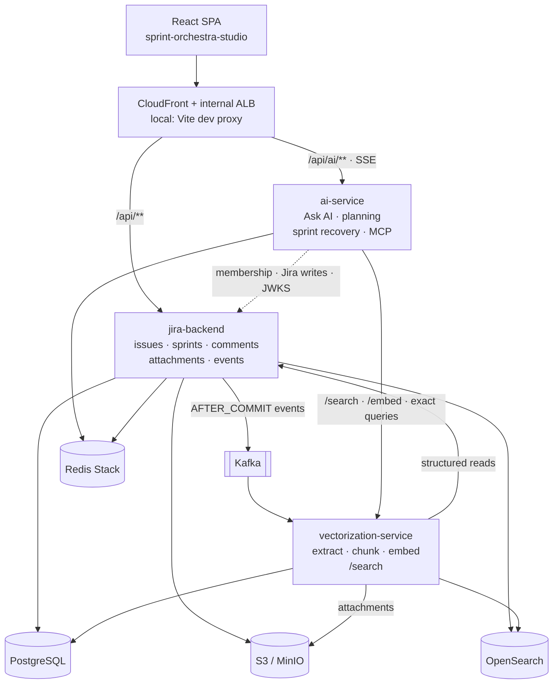
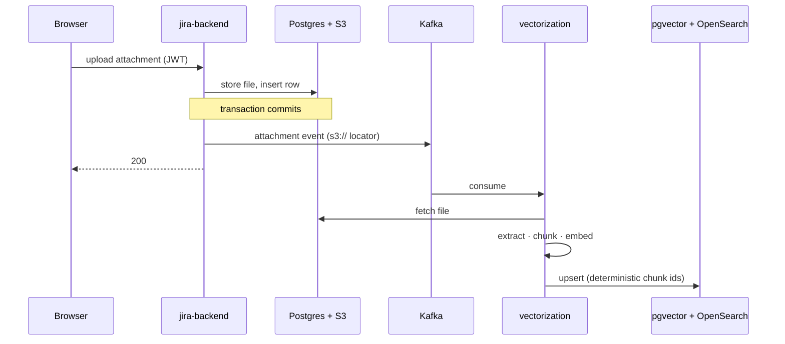

# Platform Architecture

How the Sprint Orchestra services fit together. The AI layer has its own document,
[AI_ARCHITECTURE.md](AI_ARCHITECTURE.md).

## Components

| Service | Responsibility |
|---------|----------------|
| `jira-backend` (Spring Boot) | Spaces, sprints, issues, comments, attachments, users and permissions. Source of truth for business data. Publishes a Kafka event after every committed content change. Serves the search bar. |
| `vectorization-service` (FastAPI) | Consumes content events, extracts text from attachments, chunks and embeds it, and owns the retrieval index and its raw query API. |
| `ai-service` (FastAPI) | Every AI feature: Ask AI, task drafting, Plan Epic, Sprint Pace, Sprint Recovery, issue-level actions, and the MCP server. |
| `litellm-gateway` | The only path to model providers. Holds the provider keys; enforces per-service keys, budgets and rate limits. |

## Principles

- **The edge only routes.** CloudFront and the ALB (or the Vite proxy locally) send `/api/ai/**` to
  ai-service with the prefix stripped, and everything else under `/api/**` to jira-backend. Each
  service verifies the RS256 JWT itself against jira-backend's `/.well-known/jwks.json`. Service-to-
  service calls use a separate internal token.
- **The service that owns the data exposes primitives; the service that owns the feature composes
  them.** vectorization-service exposes search and exact reads; ai-service decides what to call and
  how to answer.
- **PostgreSQL is the source of truth.** OpenSearch indices and the vector chunks are derived and can be
  rebuilt (`POST /internal/search/reindex` on jira-backend, `POST /search/reindex` on
  vectorization-service). `GET /healthz` on each service reports index drift.
- **Observability is cross-cutting**, not a service: see [Observability](#observability).

## Events and ingestion

jira-backend publishes after the database transaction commits (`@TransactionalEventListener(AFTER_COMMIT)`):

| Topic | Events | Payload |
|-------|--------|---------|
| `jira.content.ingestion` | `issue_upserted`, `issue_deleted`, `comment_upserted`, `comment_deleted` | The text itself |
| `jira.attachment.ingestion` | `attachment_uploaded`, `attachment_deleted` | An `s3://` locator; the consumer fetches the file |

Deletes are explicit events because the vector store is a separate copy of the text that database
cascades cannot reach. Chunks are upserted under deterministic ids (`issue:{id}`, `comment:{id}`,
`attachment:{id}#{n}`), so Kafka's at-least-once redelivery is idempotent.

## Search indices

| Index | Written by | Granularity | Used by |
|-------|------------|-------------|---------|
| `orchestra-issues`, `orchestra-comments` | jira-backend, after commit | One document per issue / comment | The search bar (`GET /api/search`) |
| `orchestra-chunks` | vectorization-service | One document per chunk, including attachment text | BM25 half of RAG hybrid search |
| `pocdb.rag.chunks` (pgvector) | vectorization-service | Same chunks, with embeddings | Vector half of RAG hybrid search |

The search bar ranks in tiers in `SearchService`: an exact issue key first, then full-text matches,
then literal substrings, then fuzzy matches, so a fuzzy guess never buries a real hit. RAG search fuses vector and BM25 ranks with
Reciprocal Rank Fusion and reranks with a cross-encoder.

## Data stores

| Store | Holds |
|-------|-------|
| PostgreSQL `pocdb.public` | Business data (Flyway migrations in `jira-backend`), AI feedback, LangGraph checkpoints |
| PostgreSQL `pocdb.rag` | Chunks and vectors, extraction cache, ingestion status, VLM retry queue. Accessed through a restricted `rag` role with no business-table privileges |
| OpenSearch | The indices above |
| Redis Stack | Spring cache, sessions, the Ask AI answer cache, per-user AI quotas |
| S3 / MinIO | Attachment files |

## Observability

- ai-service, vectorization-service and the LiteLLM gateway share one OpenTelemetry trace per request
  (W3C `traceparent`), exported to Phoenix and Langfuse.
- Both Python services expose Prometheus metrics at `GET /metrics`; every JSON log line carries the
  `trace_id`. Alert rules live in `observability/rules/slo.yml`.
- jira-backend and the Kafka hop are not traced yet.

See [observability/README.md](../observability/README.md).

## Known gaps

- The `AFTER_COMMIT` publisher has a crash window between commit and publish; an outbox or CDC
  publisher would close it. There is no dead-letter topic.
- OpenSearch writes are not atomic with PostgreSQL; drift is reported and repaired by reindex.
- Some core resource mutations still need consistent membership checks.
